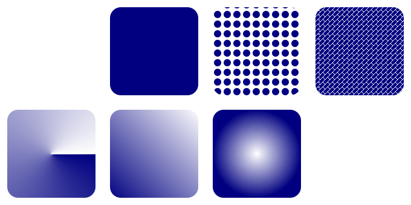

# brushes

Demonstrates how to use [brushes](https://gammasoft71.github.io/xtd/reference_guides/latest/_brushes_page.html) classes.

## Sources

* [src/brushes.cpp](src/brushes.cpp)
* [CMakeLists.txt](CMakeLists.txt)

## Build and run

Open "Command Prompt" or "Terminal". Navigate to the folder that contains the project and type the following:

```shell
xtdc run
```


## Output


