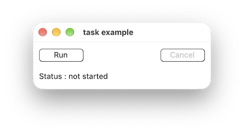
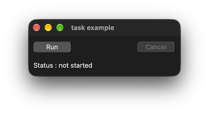

# form_and_task

demonstrates how a thread can update ui with [xtd::threading::tasks::task](https://gammasoft71.github.io/xtd/reference_guides/latest/classxtd_1_1threading_1_1tasks_1_1task_3_01void_01_4.html) class.

## Sources

* [src/form_and_task.cpp](src/form_and_task.cpp)
* [CMakeLists.txt](CMakeLists.txt)

## Build and run

Open "Command Prompt" or "Terminal". Navigate to the folder that contains the project and type the following:

```shell
xtdc run
```

## Output

### Windows :


### macOS :





### Gnome :


