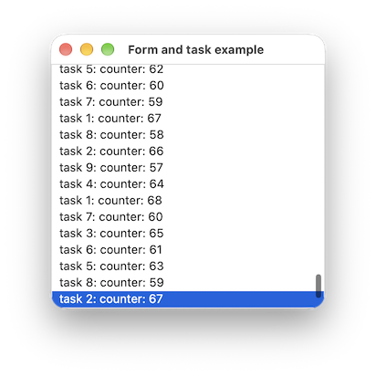
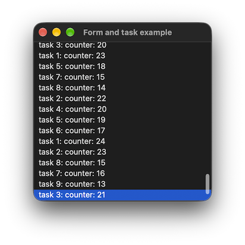
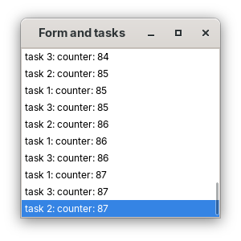
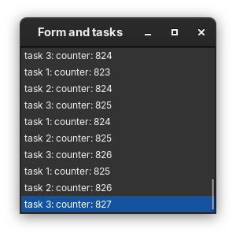

# form_and_tasks

demonstrates how a thread can update ui with [xtd::forms::control::invoke](https://gammasoft71.github.io/xtd/reference_guides/latest/classxtd_1_1forms_1_1control.html#a17ec51282322d8387937dc8dad438e32) method.

## Sources

* [src/form_and_tasks.cpp](src/form_and_tasks.cpp)
* [CMakeLists.txt](CMakeLists.txt)

## Build and run

Open "Command Prompt" or "Terminal". Navigate to the folder that contains the project and type the following:

```shell
xtdc run
```

## Output

### Windows :


### macOS :





### Gnome :




