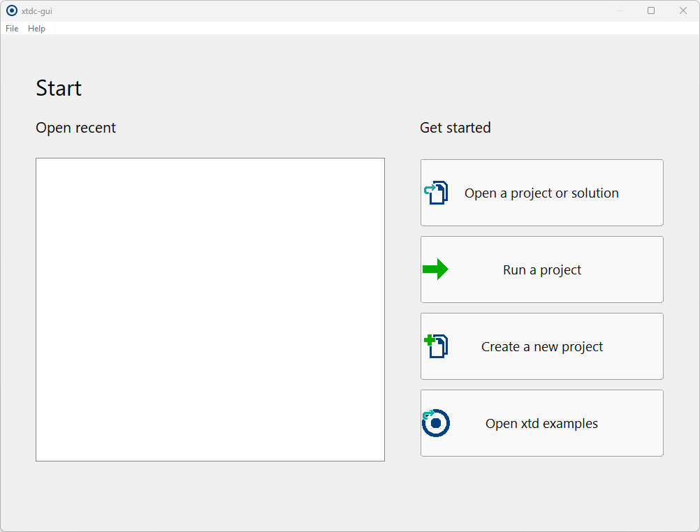
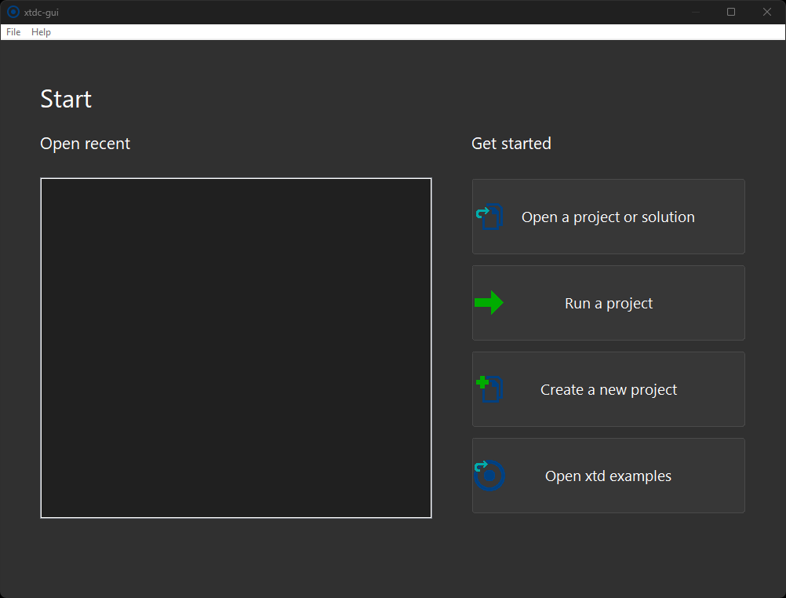
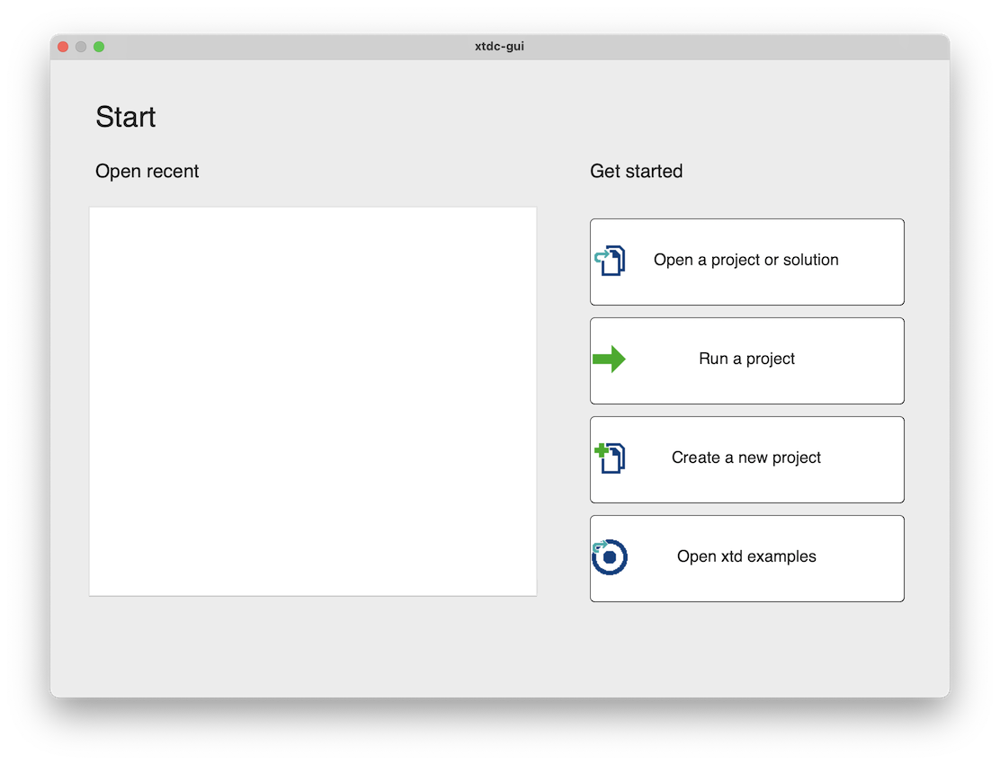
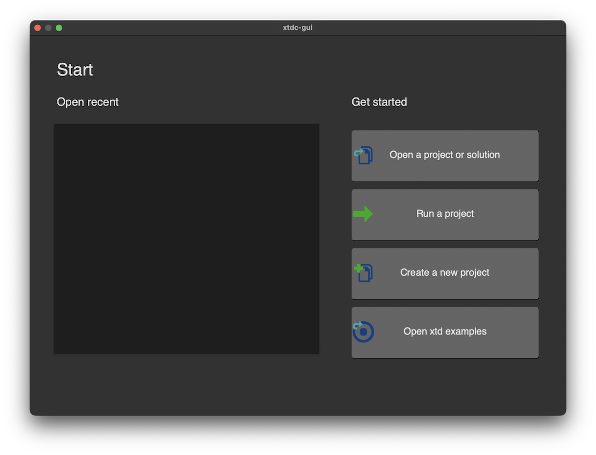
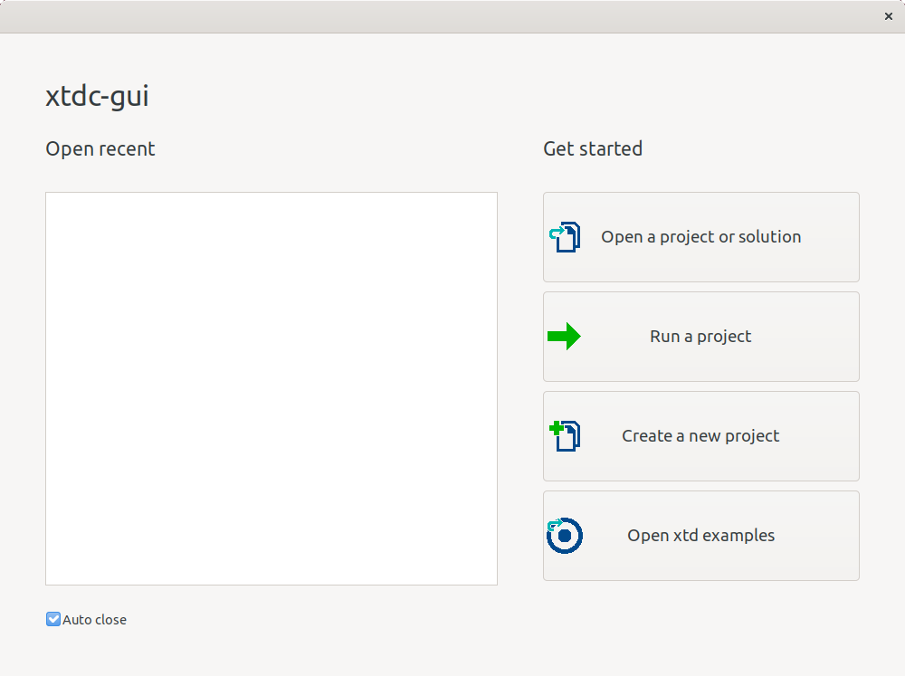
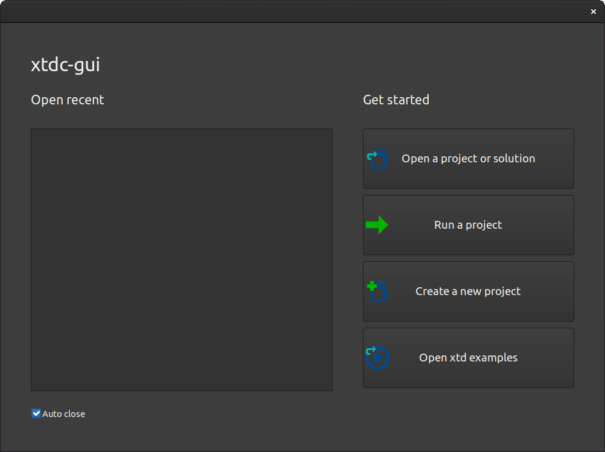

# xtdc-gui

xtdc-gui is project management GUI application.

xtdc-gui can open or run an existing project.

xtdc-gui can create and open a new project on many templates.

xtdc-gui can open an xtd example from xtd.core, xtd.forms or xtd.tunit examples.

# Templates project

xtdc-gui contains many project template. All project listed below are created with CMake and target your system (Visual Studio on Windows, Xcode on macOS and Code::Blocks or makefile on Linux).

## Console Application SDK/language :

* xtd (C++)
* c++
* c
* c#
* objective-c

## GUI Application SDK/language :

* xtd (C++)
* cocoa (Objective-C)
* fltk (C++)
* gtk (C++)
* gtk_c (C)
* gtkmm (C++)
* wxwidgets (C++)
* qt (C++)
* win32 (C++)
* win32_c (C)
* winforms (C#)
* wpf (C#)

## Shared or Static library SDK/language :

* xtd (C++)
* c++
* c
* c#
* objective-c

## Unit Test project SDK/language :

* xtd (C++)
* gtest (C++)
* catch2 (C++)

## Solution file SDK/language :

* xtd
* c++
* c
* c#
* objective-c

# Create and open a new project

* First step choose "Create a new project" button.
* Choose your project template then click to "Next" button
* Choose the name for your new project and the path where the project will be created, and finally click the "Create button" to create it.

## Windows :

## macOS :

## Linux Gnome :

______________________________________________________________________________________________

© 2026 Gammasoft.
